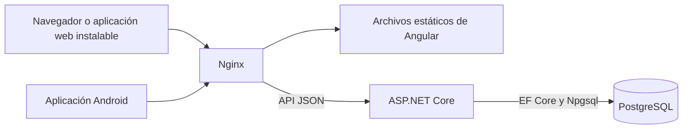

# Memoria técnica de BUMI

## Problema y alcance

Las pequeñas distribuidoras pueden registrar clientes, cotizaciones y ventas en archivos separados. Esto dificulta saber qué prospectos requieren atención, cuáles propuestas ya se aceptaron y cómo se comportan las ventas por periodo.

BUMI centraliza ese flujo para una empresa mexicana de artículos de oficina, cómputo y consumibles. La entrega de presentación contempla autenticación, clientes y prospectos, marketing, cotizaciones, ventas y estadísticas. El Word de definición sirve como antecedente de requisitos y la implementación usa PostgreSQL.

## Arquitectura

En el arranque local de Windows, ASP.NET Core sirve Angular y la API en el mismo puerto. En Docker, Nginx entrega Angular y reenvía las solicitudes bajo `/api/` a ASP.NET Core. PostgreSQL conserva los datos en un volumen. Las claves de sesión de Docker se conservan en otro volumen.

## Modelo de datos

| Entidad | Relaciones y reglas |
| --- | --- |
| Cuenta | Rol, estado, contraseña con hash y versión de sesión |
| Cliente o prospecto | Responsable, datos de contacto y conversión mediante el mismo identificador |
| Contacto y oportunidad | Varios por cliente o prospecto |
| Campaña | Relación con varios clientes o prospectos y métricas capturadas por el equipo |
| Cotización | Destinatario, vigencia, estados y partidas con cantidad, precio y descuento |
| Venta | Máximo una por cotización aceptada. La cancelación registra responsable, fecha y motivo |
| Configuración de módulos | El administrador habilita o deshabilita cada módulo operativo |

La API realiza los cálculos monetarios con un tipo decimal y redondea a centavos. Los folios se muestran a partir del identificador persistido.

## Seguridad

ASP.NET Core protege las rutas de datos mediante cookies HttpOnly, permisos por rol y comprobación del responsable cuando corresponde. El API valida las entradas y transiciones de estado. Todos los perfiles requieren contraseña y un código temporal de seis dígitos o un código de respaldo. El desafío vence en cinco minutos y admite hasta cinco intentos; los códigos aceptados no se reutilizan. La clave del autenticador se protege con ASP.NET Core Data Protection. Los códigos de respaldo se conservan con hash. La recuperación de contraseña requiere el código vigente y un código de respaldo, e invalida las sesiones existentes. Las solicitudes de escritura requieren un encabezado del mismo origen y la configuración local de Docker usa variables ignoradas por Git. Para un servidor accesible desde un teléfono, utiliza HTTPS y el entorno Production.

## Aplicación móvil e integración

El frontend está adaptado a pantallas pequeñas, tiene un manifiesto de instalación y muestra una vista de recuperación cuando se pierde la conexión. Los registros y respuestas de la API quedan fuera de la caché del service worker.

El proyecto `mobile/` agrega una aplicación Android que carga el CRM desde el servidor elegido en su pantalla de configuración. La interfaz Angular y la API comparten el origen, por lo que las autenticaciones y operaciones consultan los mismos datos que el navegador. En modo de prueba, el emulador usa `10.0.2.2:5088`; una instalación fuera del emulador requiere un servidor HTTPS o el reenvío USB de la guía. Android valida el certificado TLS y restringe la navegación al servidor configurado.

## Evidencia para la rúbrica

| Criterio | Evidencia |
| --- | --- |
| Análisis del problema y diseño del sistema | Problema, alcance, diagrama y modelo en esta memoria |
| Desarrollo del sistema web | `frontend/src` y `backend` |
| Desarrollo de la aplicación móvil | `mobile`, compilación Android y frontend instalable |
| Base de datos y arquitectura | EF Core, PostgreSQL y Docker Compose |
| Seguridad y control de acceso | Roles, sesión, protección de rutas y configuración de módulos |
| API e integración web-móvil | Misma API y base de datos en ambos clientes |
| Docker y despliegue | Dockerfiles, Compose y proxy Nginx en `docker` |
| Gestión del proyecto en GitHub | Historial Git y flujo de integración en `.github/workflows`. La ejecución remota requiere un repositorio de GitHub |
| Memoria técnica y documentación | Esta memoria y las guías de la raíz y de Android |
| Demostración y dominio técnico | Guion reproducible en `README.md` y comprobación por HTTP en `scripts/verificar.mjs` |

La recuperación usa códigos de respaldo. Los módulos fuera del alcance de presentación siguen pendientes.

## Verificación de la entrega

- Se compiló Angular y se arrancó el CRM desde la terminal integrada de Antigravity. La prueba HTTP verificó la sesión, PostgreSQL, las rutas protegidas y los recursos de instalación web.
- En el emulador Android se abrió el APK, se inició sesión y se cargó el tablero con datos de la API de Windows.
- Docker Compose pasó la validación de configuración. La comprobación de los contenedores requiere que Docker Desktop tenga su motor Linux disponible.
- Se creó la rama principal de Git y se incluyó la automatización de GitHub Actions. Falta asociar un repositorio remoto para ejecutarla.
